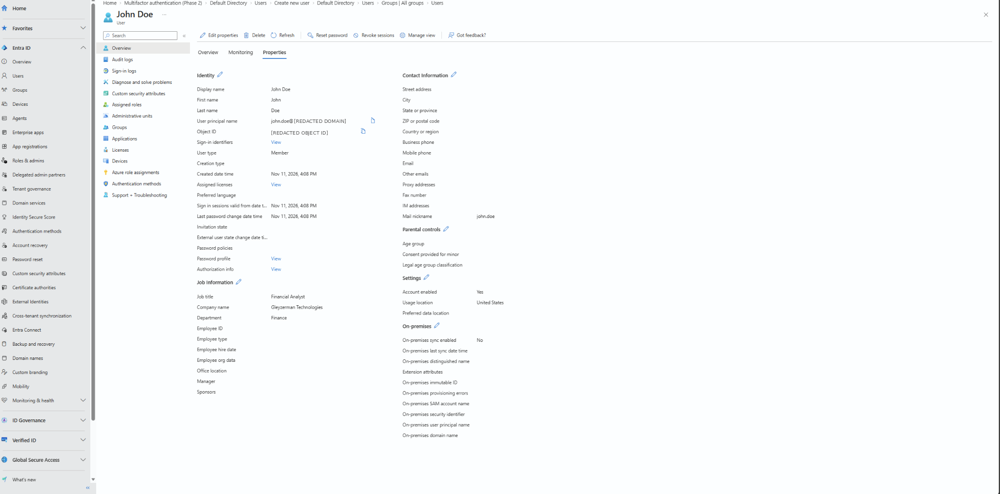
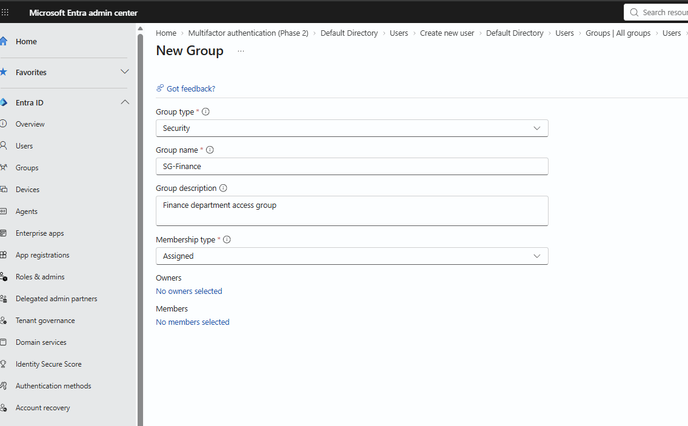
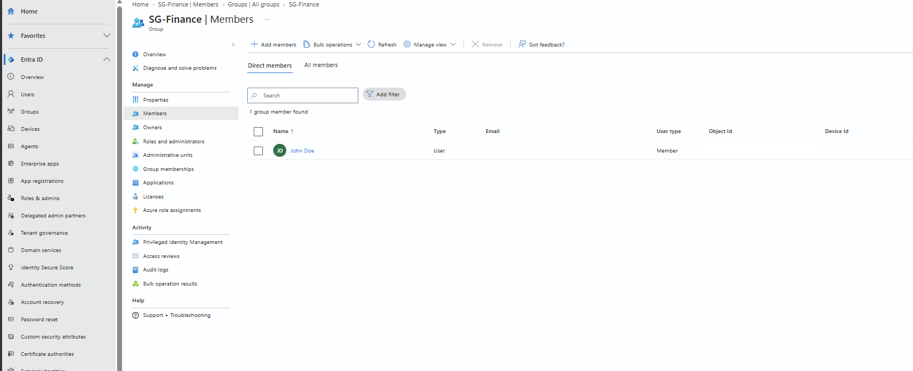
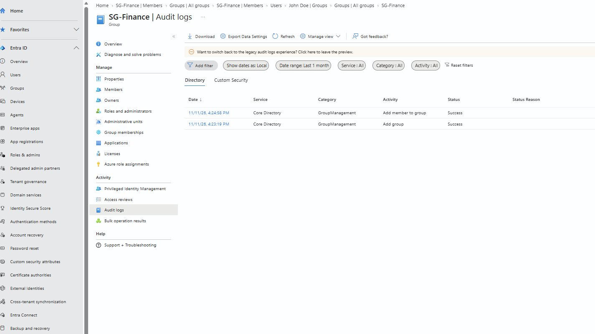

# Microsoft Entra ID — IAM Foundations Lab

**User Provisioning · Security Groups · Group Membership · Audit Logging**

## Overview

This project documents hands-on identity administration in a personal **Microsoft Entra ID Free** tenant. I simulated a fictional organization, **Gleyzerman Technologies**, and completed a basic onboarding exercise for a Finance employee named **John Doe**.

The lab demonstrates how to create a cloud identity, configure a departmental security group, assign membership, and verify that administrative actions are logged. The environment is separate from any employer's production systems.

## Lab Environment

| Item | Configuration |
| --- | --- |
| Organization | Gleyzerman Technologies (fictional) |
| Platform | Microsoft Entra ID (workforce tenant) |
| License | Entra ID Free |
| Test identity | John Doe |
| Job title | Financial Analyst |
| Department | Finance |
| Security group | `SG-Finance` |
| Group type | Security |
| Membership type | Assigned |
| Baseline protection | Security Defaults enabled |

## 1. Provision an Employee Identity

In the Microsoft Entra admin center, I navigated to **Entra ID → Users → All users → New user → Create new user** and created a cloud user with these attributes:

- **Display name:** John Doe
- **Account type:** Member
- **Department:** Finance
- **Job title:** Financial Analyst
- **Company:** Gleyzerman Technologies
- **Usage location:** United States
- **Account status:** Enabled
- **Initial credential:** Auto-generated temporary password

No administrator role was assigned to the employee account. After creation, I opened the user's **Properties** page and verified the saved identity and job information.

### Evidence — Provisioned user

*Figure 1. Created Finance employee with identity and job attributes.*

## 2. Create a Departmental Security Group

I navigated to **Entra ID → Groups → All groups → New group** and configured:

- **Group name:** `SG-Finance`
- **Group description:** Finance department access group
- **Group type:** Security
- **Membership type:** Assigned
- **Initial membership:** No members

This group provides a foundation for centralized, department-based authorization. Instead of assigning access directly to every employee, a group can later be assigned to an application or resource.

### Evidence — Group configuration

*Figure 2. Configuration of a cloud security group with assigned membership.*

## 3. Assign and Verify Group Membership

I opened **SG-Finance → Members → Add members**, selected **John Doe**, and confirmed the assignment.

I then returned to the group's **Members** page to verify that John Doe appeared as a **direct member**.

| Check | Result |
| --- | --- |
| `SG-Finance` group exists | Passed |
| Group is type Security | Passed |
| Membership is Assigned | Passed |
| John Doe is a direct member | Passed |
| Group contains one test member | Passed |

### Evidence — Confirmed membership

*Figure 3. Successful addition of John Doe to SG-Finance.*

> **Scope note:** Group membership alone does **not** prove that John Doe can access an application or resource. Actual application assignment and allowed/denied access tests are planned for a separate lab.

## 4. Review Audit Logs

I navigated to **SG-Finance → Audit logs** to confirm that Microsoft Entra recorded the administrative changes.

| Recorded activity | Category | Result |
| --- | --- | --- |
| Add group | GroupManagement | Success |
| Add member to group | GroupManagement | Success |

Both events were visible in the audit log on **November 11, 2026**. These entries provide evidence of the group-creation and membership-change operations.

### Evidence — Audit events

*Figure 4. Successful group management audit events.*

## Security and IAM Concepts Demonstrated

- **Identity provisioning:** Creating a cloud user with organizational attributes.
- **Group-based administration:** Managing departmental membership centrally.
- **Least privilege:** Creating a non-administrative employee account without elevated roles.
- **Security baseline:** Verifying that tenant Security Defaults are enabled.
- **Auditability:** Confirming that directory changes are recorded as successful audit events.

## Outcome

One Finance employee was provisioned, one security group was created, the employee was added as a direct member, and the relevant group audit events were verified.

This lab focuses on **foundational identity administration**, not full RBAC enforcement, SSO, Conditional Access, or end-to-end Joiner–Mover–Leaver automation.

## Planned Follow-up Labs

1. Assign a security group to a test enterprise application and verify allowed/denied access.
2. Simulate a Finance-to-HR transfer by changing group memberships and verifying access removal.
3. Disable a departing employee account and revoke sessions.
4. Automate identity and group reporting with Microsoft Graph PowerShell.
5. Explore privileged access and identity governance features where trial licensing permits.

---

**Privacy note:** All employee data is fictional. Personal tenant-domain information and object identifiers are redacted where appropriate in public screenshots. No passwords, MFA secrets, or tokens are published.
